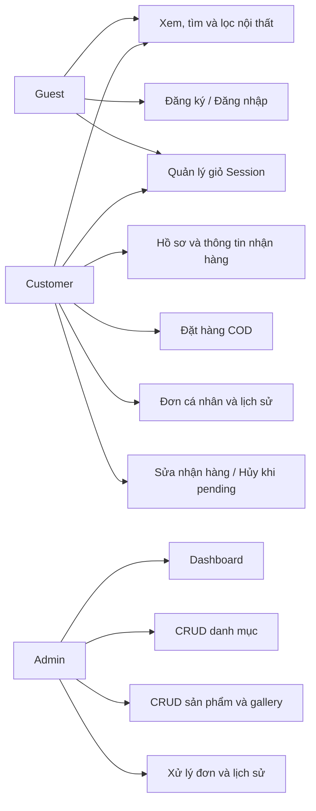
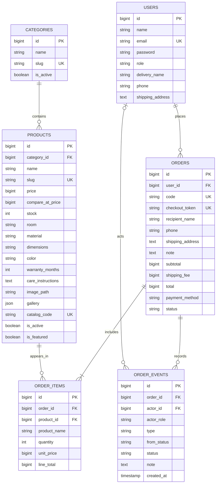
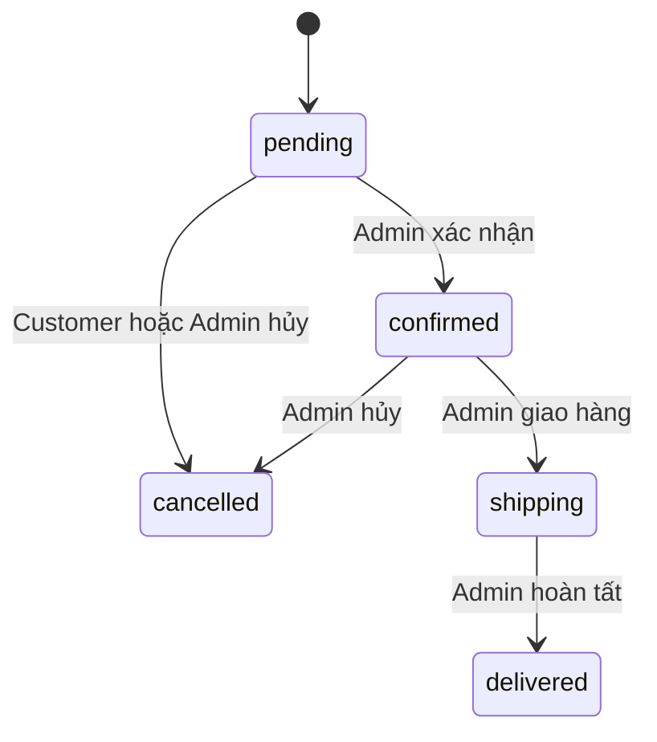

# Báo cáo kỹ thuật — NEST Market

Cập nhật theo mã nguồn ngày 28/10/2026. Đây là tài liệu kỹ thuật làm cơ sở cho báo cáo môn học; nhóm cần bổ sung thông tin thành viên, phân công thực tế, bìa theo mẫu trường và ảnh minh chứng trước khi nộp.

## 1. Đề tài và mục tiêu

NEST Market là website nội thất và đồ trang trí, triển khai đề tài Website Bán hàng Online phiên bản đơn giản. Hai vai trò được lưu trong database là Admin và Customer; Guest là người chưa đăng nhập.

Hệ thống phục vụ luồng chọn sản phẩm → giỏ hàng → đặt COD → xử lý đơn → xem lịch sử. Giao diện tham khảo cách tổ chức nội dung của MOHO, dùng thương hiệu NEST và dữ liệu minh họa cho học tập.

Công nghệ: PHP 8.2+, Laravel 12, Eloquent, Blade, Bootstrap lưu local, CSS, JavaScript/Fetch và MySQL. Môi trường chính là Docker Compose với PHP 8.3 FPM, Nginx 1.28 và MySQL 8.4. Laragon là phương án chạy trực tiếp tùy chọn.

## 2. Yêu cầu và tác nhân

| Tác nhân | Phạm vi |
| --- | --- |
| Guest | Xem/tìm/lọc/sắp xếp sản phẩm, xem gallery/thông số, tạo giỏ, đăng ký/đăng nhập |
| Customer | Các thao tác mua hàng, cập nhật hồ sơ, lưu thông tin nhận hàng, xem đơn của mình, sửa/hủy đơn pending |
| Admin | Dashboard, CRUD danh mục/sản phẩm, upload ảnh, quản lý đơn và chuyển trạng thái |

### Sơ đồ tác nhân và chức năng

Sơ đồ dưới thể hiện quan hệ chức năng, không thay thế bản UML Use Case theo ký pháp mà giảng viên yêu cầu.



### Nhóm chức năng

- Tài khoản và phân quyền.
- Khám phá nội thất: phòng, danh mục, hàng mới, ưu đãi, tìm kiếm/lọc/sắp xếp/phân trang.
- Chi tiết sản phẩm: gallery, thông số, bảo hành/chăm sóc, sản phẩm liên quan.
- Giỏ và checkout: AJAX, Mua ngay, COD, phí giao hàng, gợi ý tỉnh/thành.
- Hồ sơ và đơn cá nhân: lưu thông tin nhận hàng, sửa/hủy trước xác nhận, timeline.
- Admin: danh mục, sản phẩm/ảnh/tồn kho, đơn hàng và dashboard.

Số chức năng phụ thuộc cách nhóm thao tác; không dùng số route làm số chức năng nghiệp vụ.

## 3. Thiết kế dữ liệu

Có 8 migration, 6 bảng nghiệp vụ, bảng password_reset_tokens hỗ trợ và bảng migrations do Laravel quản lý. Bảng password_reset_tokens không đồng nghĩa đã có chức năng quên mật khẩu.

### ERD rút gọn

Chỉ liệt kê các trường chính; kiểu dữ liệu đầy đủ, độ dài, index và ràng buộc xem trong database/migrations.



order_items giữ tên và đơn giá lúc mua, tránh thay đổi lịch sử khi Admin sửa sản phẩm. Thông tin nhận hàng trên order là bản chụp riêng, không tự thay đổi theo hồ sơ. order_events ghi hành động, trạng thái, người thao tác và thời gian; đơn trước migration chỉ có mốc bắt đầu theo dõi, không suy diễn các bước cũ.

Seeder mới tạo 2 tài khoản, 5 danh mục và 16 sản phẩm. Không tạo sẵn đơn hàng. Seeder giữ chỉnh sửa trên dữ liệu đã tồn tại; chuyển catalog cũ bằng cách ẩn một số sản phẩm demo cũ, giữ dữ liệu lịch sử.

## 4. Kiến trúc

- Route: routes/web.php.
- Controller: Shop, Auth, Cart, Checkout, Profile, Order, Province và các controller Admin.
- Model: User, Category, Product, Order, OrderItem, OrderEvent; quan hệ Eloquent, scopes và accessors.
- Service: OrderWorkflow điều phối sửa nhận hàng, chuyển trạng thái, hoàn kho và ghi event.
- Support: Cart chuẩn hóa số lượng Session theo trạng thái/tồn kho thực tế.
- View: Blade layout storefront/admin, components card/notification/dialog/timeline.
- Middleware: auth, guest, admin, customer và throttle.
- Validation: Form Request và validate ở controller; server kiểm tra dữ liệu độc lập với JavaScript.
- Upload: public disk; Docker Nginx đọc shared storage volume, chạy trực tiếp dùng storage:link.

## 5. Luồng đặt hàng và xử lý đơn

```mermaid
sequenceDiagram
    actor Customer
    participant Browser
    participant Checkout as CheckoutController
    participant DB as MySQL
    Customer->>Browser: Thêm hàng, mở checkout
    Browser->>Checkout: GET /thanh-toan
    Checkout-->>Browser: Giỏ đã chuẩn hóa và checkout_token
    Customer->>Browser: Gửi thông tin nhận hàng, chọn COD
    Browser->>Checkout: POST /thanh-toan
    Checkout->>DB: Transaction, khóa customer
    Checkout->>DB: Tìm order theo user và checkout_token
    alt Token đã được xử lý
        DB-->>Checkout: Đơn hiện có
        Checkout-->>Browser: Chuyển đến đơn cũ
    else Yêu cầu mới
        Checkout->>DB: Khóa sản phẩm theo thứ tự ID
        Checkout->>Checkout: Kiểm tra giá, tồn kho, trạng thái, số lượng
        alt Dữ liệu hợp lệ
            Checkout->>DB: Tạo order, items, event; trừ tồn; commit
            Checkout-->>Browser: Chi tiết đơn mới
        else Không hợp lệ
            Checkout->>DB: Rollback
            Checkout-->>Browser: Thông báo lỗi, không tạo đơn dở dang
        end
    end
```

Phí giao hàng 30.000đ, miễn phí từ 800.000đ tiền hàng. Mỗi sản phẩm trong giỏ tối đa min(tồn kho, 100). Giá và tổng tiền do server xác định.



Customer chỉ sửa thông tin/hủy khi pending; hủy cần lý do. OrderWorkflow khóa và đọc lại đơn từ database, kiểm tra chuyển trạng thái, hoàn tồn và lưu event trong transaction. Hủy lặp không được hoàn tồn thêm lần nữa.

## 6. Điểm mở rộng và UX

- Upload ảnh bìa và gallery, tối đa 6 ảnh gallery, JPG/PNG/WebP 3 MB/file.
- Thêm/sửa giỏ qua AJAX, badge và tổng tiền cập nhật.
- Province Open API v2 qua backend, timeout 5 giây, cache một ngày; lỗi trả thông báo và vẫn cho nhập địa chỉ thủ công.
- Gallery/phóng to, bộ lọc nội thất, thông tin mặc định và timeline giúp luồng mua hàng rõ hơn.
- Toast tự đóng, trạng thái đang gửi, xác nhận thao tác, Inter lưu local, responsive và giảm chuyển động theo tùy chọn hệ điều hành.
- Checkout token, transaction/row lock và eager loading hỗ trợ tính nhất quán và giảm truy vấn thừa.

## 7. Kiểm thử và triển khai

Lệnh chạy, kết quả và phạm vi xác nhận: [VERIFICATION.md](VERIFICATION.md). Kịch bản thao tác: [KIEM_THU.md](KIEM_THU.md). Đối chiếu điểm: [BAREM.md](BAREM.md).

Docker lưu database và uploads trong named volumes. Khi đổi máy cần chạy script setup; database demo cá nhân không được đóng gói trong Git. PHPunit dùng SQLite :memory:, không dùng database MySQL demo.

Ảnh minh chứng nên chụp: trang chủ; bộ lọc; gallery/thông số; giỏ AJAX; checkout; hồ sơ; đơn/timeline; hộp thoại hủy; dashboard; form gallery Admin; phân quyền 403; mobile và kết quả test. Không ghi đã kiểm tra thiết bị/kích thước chưa thực sự kiểm tra.

## 8. Giới hạn và hướng phát triển

COD mô phỏng; chưa có ví/thẻ, voucher, đánh giá, biến thể SKU, nhiều kho, đồng bộ giỏ giữa thiết bị, quy trình đổi trả/hoàn tiền tự động. Dữ liệu giá/thông số và ảnh là minh họa đồ án. Báo cáo không khẳng định hệ thống sẵn sàng production hay được trọn điểm.

Nhóm bổ sung phân công đúng thực tế, ảnh màn hình và biểu đồ UML theo yêu cầu giảng viên, diễn tập luồng Customer → Admin và giải thích code từng phần.

## 9. Câu hỏi bảo vệ

1. Migration định nghĩa cấu trúc/quan hệ; Seeder tạo dữ liệu mẫu.
2. Eloquent là ORM, ánh xạ đối tượng và quan hệ thành truy vấn SQL.
3. Middleware chặn request sai vai trò; kiểm tra ownership chặn truy cập đơn người khác.
4. order_items lưu dòng hàng và giá lịch sử; order_events lưu diễn biến.
5. Transaction giúp tạo đơn/trừ kho/event cùng thành công hoặc cùng rollback.
6. Row lock bảo vệ thao tác đồng thời; token xử lý yêu cầu checkout lặp.
7. Upload cần dọn file mới khi DB lỗi và chỉ xóa ảnh cũ sau khi DB lưu thành công.
8. Docker đóng gói môi trường chạy; không thay thế Laravel hay MySQL.
9. Asset local giảm phụ thuộc mạng; API tỉnh/thành vẫn là dịch vụ ngoài.
10. Trình bày kết quả test kèm phạm vi; test qua không chứng minh mọi lỗi đều đã hết.
