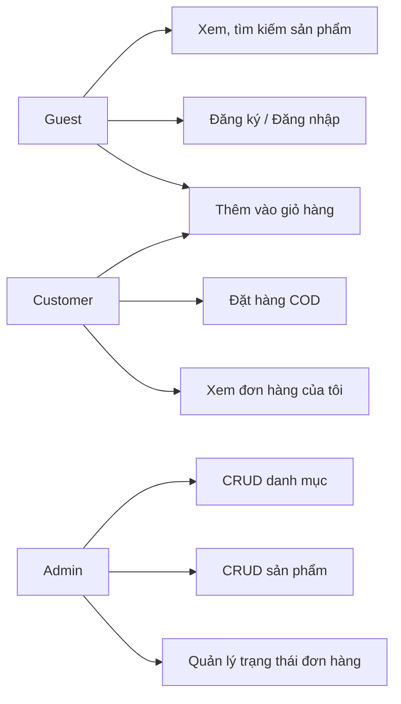
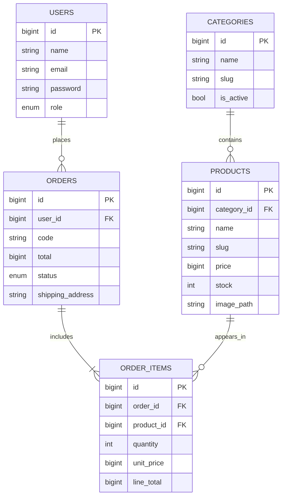

# ĐỀ CƯƠNG BÁO CÁO ĐỒ ÁN — WEBSITE BÁN HÀNG ONLINE

> Các nội dung thực nghiệm (ảnh màn hình, thời gian chạy, kết quả testcase) chỉ điền sau khi đã thực sự chạy app trên Laragon. Không nên chèn kết quả chưa kiểm chứng.

## 1. Giới thiệu đề tài

- Tên: Website Bán hàng Online (phiên bản đơn giản) — NEST Market.
- Mục tiêu: tạo website giới thiệu/đặt mua sản phẩm đồ dùng/lifestyle, có quy trình đặt hàng COD, quản lý danh mục/sản phẩm và phân quyền.
- Công nghệ: PHP ≥8.2, Laravel 12, Eloquent ORM, Blade, Bootstrap 5, MySQL, AJAX, Laragon, VS Code.
- Phương pháp kiến trúc: MVC, các chức năng CRUD và quản lý tài khoản.

## 2. Phân tích yêu cầu

### Tác nhân và use case

- **Guest:** xem danh mục/sản phẩm, tìm kiếm, thêm giỏ (Session), đăng ký, đăng nhập.
- **Customer:** mua hàng, điền địa chỉ, xem đơn hàng cá nhân.
- **Admin:** xem thống kê, quản lý danh mục, sản phẩm, đơn hàng, cập nhật trạng thái và xử lý hủy.



### Luồng đặt hàng

```mermaid
sequenceDiagram
    actor Khach as Customer
    participant V as Blade / Browser
    participant C as CheckoutController
    participant DB as MySQL (Eloquent)
    Khach->>V: Chọn số lượng, thêm giỏ
    V->>V: AJAX / Session cart
    Khach->>V: Xác nhận COD
    V->>C: POST /thanh-toan
    C->>DB: Transaction + lock sản phẩm
    DB-->>C: Giá và số lượng hiện tại
    alt Đủ tồn kho
      C->>DB: Tạo orders, order_items; giảm stock
      C-->>V: Chuyển đến chi tiết đơn
    else Thiếu hàng
      C-->>V: Validation error
    end
```

## 3. Thiết kế dữ liệu



Giải thích: `orders` lưu thông tin tổng đơn; `order_items` lưu chi tiết với **giá tại thời điểm đặt hàng**, không phụ thuộc giá mới của `products`. Các khóa ngoại bảo vệ tính toàn vẹn dữ liệu.

## 4. Thiết kế kiến trúc MVC

- **Route:** `routes/web.php` quyết định controller xử lý yêu cầu.
- **Controller:** `ShopController`, `CartController`, `CheckoutController`, `OrderController`, controller Admin.
- **Model (Eloquent):** `User`, `Category`, `Product`, `Order`, `OrderItem` — ánh xạ bảng và khai báo quan hệ.
- **View:** Blade tại `resources/views`, layout customer/admin, partial `product-card`.
- **Middleware:** `auth`, `guest`, `admin`, `customer`, `throttle`.
- **Form Request:** `CheckoutRequest`, `ProductRequest`, `CategoryRequest` để validation.

## 5. Giao diện cần chụp màn hình

1. Trang chủ khách hàng (hero + danh mục + sản phẩm nổi bật).
2. Danh sách sản phẩm, ô tìm kiếm và phân trang.
3. Trang chi tiết sản phẩm.
4. Giỏ hàng và cập nhật AJAX.
5. Trang thanh toán và chọn tỉnh/thành từ API.
6. Trang lịch sử và chi tiết đơn hàng Customer.
7. Trang đăng nhập / đăng ký.
8. Dashboard Admin.
9. CRUD danh mục và sản phẩm Admin.
10. Quản lý đơn hàng và cập nhật trạng thái.
11. Màn hình validation lỗi và giao diện mobile (390px).

## 6. Kiểm thử cần mô tả

- Form đăng ký: email trùng, mật khẩu không đủ độ mạnh, hợp lệ.
- Phân quyền: Customer truy cập `/admin` trả 403; guest bị redirect đăng nhập.
- Thao tác CRUD category + product, upload ảnh, kiểm tra danh mục đang được dùng không xóa được.
- Sản phẩm tìm kiếm, lọc danh mục, phân trang, sắp xếp.
- Thêm giỏ vượt tồn kho bị từ chối; AJAX tăng giảm số lượng.
- Đặt hàng hợp lệ → lưu order/item và giảm stock; hủy hợp lệ → hoàn stock.
- Customer A truy cập đơn Customer B → 403.
- Mobile UI không tràn màn hình, nút hoạt động tốt.

## 7. Kết luận

Hệ thống áp dụng mô hình MVC của Laravel, lưu dữ liệu với Eloquent, có phân quyền và luồng bán hàng COD hoàn chỉnh trong phạm vi demo. Có thể mở rộng sang payment gateway, voucher hoặc quản lý tồn kho nâng cao sau khi hoàn thiện bài học.

## 8. Câu hỏi bảo vệ thường gặp

1. **MVC là gì?** Model tương tác dữ liệu; View hiển thị; Controller tiếp nhận request và điều phối nghiệp vụ. Route ánh xạ URL.
2. **Khác nhau giữa Migration và Seeder?** Migration định nghĩa/thay đổi cấu trúc database; Seeder thêm dữ liệu mẫu.
3. **Eloquent khác query SQL thủ công?** Eloquent là ORM, biểu diễn bảng/quan hệ qua đối tượng, hỗ trợ eager loading, scopes, CRUD; không có nghĩa SQL tự biến mất.
4. **Vì sao có bảng `order_items`?** Quan hệ N-N giữa Orders và Products thông qua dòng chi tiết, lưu số lượng và giá lịch sử.
5. **Middleware dùng để làm gì?** Lọc request trước khi vào controller; bảo vệ các route yêu cầu xác thực hoặc role.
6. **Vì sao đăng nhập xong phải regenerate session?** Giảm rủi ro session fixation.
7. **Vì sao phải khóa sản phẩm khi đặt?** Tránh hai đơn đồng thời đều đọc số lượng cũ rồi bán quá tồn kho.
8. **AJAX sử dụng ở đâu?** Thêm và cập nhật giỏ hàng bằng fetch() trả JSON mà không reload.
9. **API ngoài dùng ra sao?** Backend gọi Province Open API v2 qua HTTP client; Cache 1 ngày; UI lấy danh sách từ route nội bộ, fallback nếu mất mạng.
10. **Vì sao Bootstrap vẫn phải viết CSS?** Bootstrap hỗ trợ layout responsive và biểu mẫu; CSS riêng tạo thương hiệu/chi tiết UI khác biệt.
